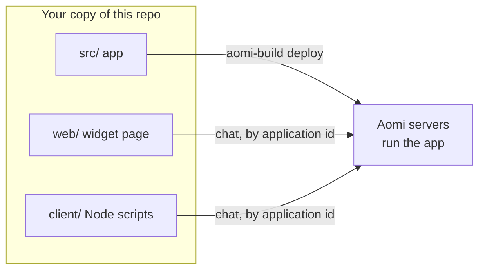

# Aomi app template

This repo is a small Aomi app you can deploy as is, then edit. It has two
halves:

- **The app** is the Rust code at the repo root. Aomi builds it and runs it on
  its servers. The model calls its tools.
- **The callers** are `web/` and `client/`. They run on your machine and talk to
  the deployed app over the network, by its application id.

The callers are examples. You don't need them to use your app. They show the
code you would write in your own product to reach it.



## How to use this repo

1. Make your own copy. Use "Start from the template" in Aomi Build, or "Use this
   template" on GitHub. Never connect this template repo itself as a Project.
2. Test the app locally with `cargo test`.
3. Deploy it. You get a running app with an application id.
4. Talk to it from the widget page or the Node client.
5. Change the tools, bump `BUILD` in `src/lib.rs`, and deploy again.

Each step has a section below.

## What's in the repo

| Path | What it is | When you touch it |
| --- | --- | --- |
| `src/lib.rs` | App entry. Declares the name, the preamble, the tools and the skill. | To add a tool or change what the model is told |
| `src/tools.rs` | `greet` and `about`. The model always sees these. | To change or add always-on tools |
| `src/cafe.rs`, `src/menu.json` | `menu_search` and `order_total`, plus their data. | As a model for your own skill tools |
| `src/skill/cafe.md` | Instructions for the `playground-example/cafe` skill. | To change how the model uses the skill |
| `tests/tools.rs` | Tests every tool, the manifest, and which skill owns each tool. | Whenever you change a tool |
| `aomi.toml` | App name, display name, catalog visibility, server tags. | When you rename the app or go to production |
| `.aomi/config.json` | Tells Build which `aomi.toml` files to deploy. | Rarely |
| `web/` | A Vite and React page with `<AomiWidget>` in direct mode. | To see your app in a chat UI |
| `client/` | Node scripts that use the published `@aomi-labs/client`. | To call your app from code |

### The app

`greet` and `about` are always available to the model. `menu_search` and
`order_total` belong to the `playground-example/cafe` skill. The model sees them
only after it activates the skill.

`about` reports the `BUILD` constant from `src/lib.rs`. Bump it when you ship a
change, so you can tell which build answered.

Keep the `aomi-sdk = "=6.0.0"` pin in `Cargo.toml`. It must match the backend
runtime exactly. The deploy preflight rejects any other version.

To rename the app, change `name` in `dyn_aomi_app!` in `src/lib.rs` and `name`
in `aomi.toml`. The two must match.

## Test locally

```sh
cargo test --locked
pnpm install
pnpm -r typecheck
```

The Rust build never touches the JS workspace. CI runs the same checks in
`.github/workflows/check.yml`.

A local run with `aomi-run` shows the model every tool from the start. Skill
gating only happens on Aomi's servers, so test the café skill after you deploy.

## Deploy

Both paths end with a Project that deploys your copy of this repo.

### From Build

Open Aomi Build at [build.aomi.dev](https://build.aomi.dev). Choose "Start from
the template", or import a repo you made with "Use this template" on GitHub.
Build creates the Project, so you can skip `aomi-build project create`.

### From the CLI

Install the CLI. Version 6.0.2 or later is required.

```sh
cargo install aomi-sdk --version 6.0.2 --features cli --locked
```

Run these from your clone:

```sh
aomi-build login --backend https://api.aomi.dev
aomi-build project create
aomi-build deploy
```

- `aomi-build login` opens GitHub in your browser to sign you in. It saves the
  backend URL, so later commands reuse it.
- `aomi-build project create` prints a GitHub authorization page for your repo.
  Approve it within 10 minutes as a GitHub user with admin on the repo. The
  Project is created when you approve. The command reads the repo from your
  `origin` remote.
- `aomi-build deploy` checks that your tree is clean and pushed and that the SDK
  pin matches. Then it builds, activates and checks the app. It ends by
  printing the release tag.

Useful flags for `project create`:

- `--repo owner/name` names the repo. It must match your `origin` remote.
- `--platform <name>` picks the platform. The default is `community`.
- `--build-url <url>` sets the Aomi Build URL. It is inferred from the backend.
- `--no-browser` prints the URL instead of opening a browser.

### Staging

Use the staging hosts for every step:

- Build: [build-staging.aomi.dev](https://build-staging.aomi.dev)
- CLI: `aomi-build login --backend https://api-staging.aomi.dev`
- Chat: `https://chat-staging.aomi.dev`, set through the env files below

`aomi.toml` leaves `server_tags` unset, which means only staging servers load
your release. Set `server_tags = ["prod"]` once you have tested it on staging.

### Find your application id

The widget and the client need the application id. The CLI does not print it
yet. Look it up in the public catalog by the release tag that `aomi-build
deploy` printed:

```sh
curl -s "https://chat-staging.aomi.dev/api/public/catalog/apps?platform=community" \
  | jq '.[] | select(.app_release_tag == "<your release tag>")'
```

Use `https://chat.aomi.dev` for production.

Every deploy prints a new release tag. Look the id up again after you redeploy.
This lookup only works while `public = true` in `aomi.toml`.

## Talk to your app

Both callers send every message straight to your app in direct mode. Without
direct mode, the Auto agent answers instead of your app.

Both use the production chat host by default and print the host they use when
they start. For staging, set `VITE_AOMI_BASE_URL` in `web/.env` or
`AOMI_BASE_URL` in `client/.env` to `https://chat-staging.aomi.dev`.

### Widget page

```sh
cp web/.env.example web/.env      # set VITE_AOMI_APPLICATION_ID
pnpm install
pnpm --filter web dev
```

Open http://localhost:5173. The page in `web/src/main.tsx` is the code to copy
into your own site.

### Node client

```sh
cp client/.env.example client/.env      # set AOMI_APPLICATION_ID
pnpm install
pnpm --filter client ask "Greet Ada, excitedly"
pnpm --filter client tour
```

The client is example code on top of the published `@aomi-labs/client`
package. It has three files:

- `client/src/turn.ts` is the part to copy into your own code. It creates the
  client, sends a prompt in direct mode to your application id, and prints the
  tools that ran (`tool_complete` events) and the reply.
- `client/src/run.ts` is `ask`. It sends one prompt and exits.
- `client/src/tour.ts` is `tour`. It runs a fixed conversation that checks your
  deploy end to end.

`tour` runs three sessions. Each one checks something you can only see on a
deployed app:

| Session | Prompts | What it shows |
| --- | --- | --- |
| 1 | "Which build are you?", "Greet Ada, excitedly", the price of two Nebula Lattes and a Moon Mochi | `about` returns your `BUILD`. `greet` runs with `excited: true`. The model activates the café skill, then calls `menu_search` and `order_total` (1180 cents, $11.80). |
| 2 | "Greet Bob" | A new session starts with the skill off. Only `greet` runs. |
| 3 | "Order 50 Comet Croissants", "add item C-99" | Tool errors come back as plain messages, and the next turn still works. |

Run `tour` after every deploy. If a session doesn't show the tools in the
table, the deploy isn't working as expected.

## When something fails

| You see | What it means | What to do |
| --- | --- | --- |
| Preflight rejects the SDK version | `Cargo.toml` doesn't pin `aomi-sdk = "=6.0.0"` | Restore the exact pin |
| `402 builder_debt` | Your Builder credit balance is below zero. Every chat to your apps stops, guests included. | Add credit in Build |
| `429` on guest sign-in | The chat host limits guest sign-ins per IP | Wait for the `retry-after` time, then rerun |
| `403 forbidden` from the client | The application id is wrong or not yours | Look the id up again in the catalog |
| Replies come from the Auto agent | The caller isn't in direct mode | Keep the `direct` target in `turn.ts` and `main.tsx` |
| The café tools never run | The skill wasn't activated, or you are testing locally | Test on a deployed app and ask about the menu |
